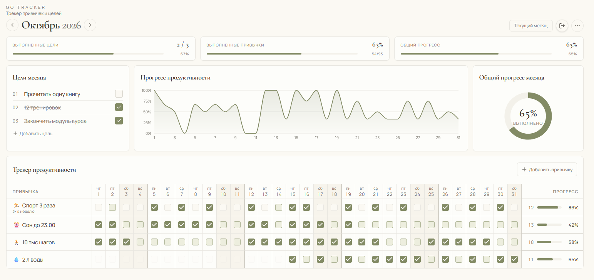
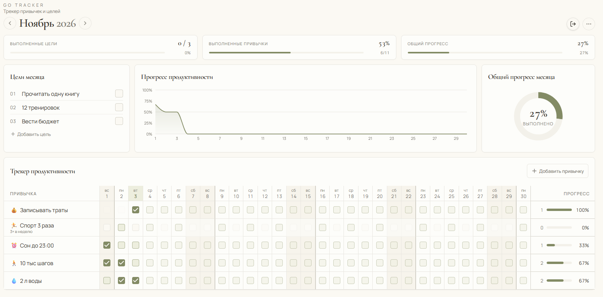

# GO Tracker — трекер привычек и ежемесячных целей

GO Tracker — веб-приложение для планирования личных целей, формирования привычек и отслеживания прогресса. Приложение объединяет календарный трекер, гибкое расписание привычек, месячные цели и визуальную аналитику выполнения.

Проект разработан как функциональный MVP с использованием AI-assisted development и платформы Lovable.

[Открыть приложение](https://go-tracker-olga.lovable.app/) · [Исходный код](https://github.com/Olyshon/go-tracker)

## Интерфейс приложения

На скриншотах представлены демонстрационные данные.

### Октябрь 2026

Главный экран с заполненными привычками, целями и графиками.



### Ноябрь 2026

Текущий месяц: календарный трекер и прогресс выполнения.



## Возможности

### Трекер привычек

- Создание, редактирование и завершение привычек.
- Настройка периодичности: ежедневно, несколько раз в неделю или месяц.
- Выбор предпочтительных дней недели.
- Указание даты начала и окончания привычки.
- Отметка выполнения в календарной таблице.
- Автоматический расчёт индивидуального прогресса.

### Работа с историей

- Привычки продолжаются в следующих месяцах в пределах периода действия.
- Изменение расписания применяется с выбранного месяца, не переписывая предыдущие периоды.
- История выполнения сохраняется при переходе между месяцами.
- Завершение привычки не требует удаления её прошлых результатов.

### Ежемесячные цели

- Добавление, редактирование и удаление целей.
- Отметка выполненных целей.
- Независимое хранение целей для каждого месяца.
- Подтверждение перед удалением.

### Аналитика прогресса

На главном экране отображаются:

- Процент выполнения привычек.
- Доля выполненных целей.
- Общий показатель прогресса.
- График ежедневной продуктивности.
- Круговая диаграмма общего прогресса.

Показатели автоматически пересчитываются при изменении отметок.

### Пользовательские аккаунты

- Регистрация и вход по email.
- Подтверждение электронной почты.
- Восстановление пароля через email.
- Сохранение данных в облачной базе.
- Разделение данных между пользователями с использованием политик доступа к строкам (RLS).

## Технологический стек

| Область | Технологии |
| --- | --- |
| Frontend | React 19, TypeScript |
| Маршрутизация | TanStack Router / Start |
| Стилизация | Tailwind CSS 4 |
| Компоненты интерфейса | Radix UI |
| Графики | Recharts |
| Работа с датами | date-fns |
| Backend и авторизация | Lovable Cloud, Supabase |
| База данных | PostgreSQL |
| Разработка | Lovable, GitHub |
| Проверки и качество кода | Vitest, ESLint, Prettier |

## Особенности реализации

**Гибкая модель привычек.** Приложение учитывает разные типы периодичности, выбранные дни недели и индивидуальные сроки действия привычек.

**Сохранение исторических настроек.** Изменение частоты выполнения не должно менять ранее действовавшее расписание. Это позволяет корректно рассчитывать прогресс за прошлые месяцы.

**Облачное хранение.** Первоначальная версия использовала localStorage. В дальнейшем приложение было переведено на Lovable Cloud с пользовательской авторизацией и сохранением данных в PostgreSQL.

**Изоляция данных.** Доступ к пользовательским записям ограничивается на уровне базы данных с помощью RLS.

**Проверка сценариев.** В процессе разработки тестировались сохранение данных, переходы между месяцами, изменения расписаний, регистрация, авторизация и разграничение доступа.

## Процесс разработки

Проект создан с использованием Lovable и AI-инструментов.

Работа включала формулирование требований, проектирование пользовательских сценариев, последовательную реализацию функций, проверку поведения приложения и корректировку решений по результатам тестирования.

Особое внимание уделялось сохранности пользовательских данных, корректности расчётов и согласованности поведения приложения при изменении расписаний.

## Локальный запуск

Необходимы Node.js и npm.

```sh
git clone https://github.com/Olyshon/go-tracker.git
cd go-tracker
npm install
npm run dev
```

Для работы с облачными данными требуется конфигурация подключения к соответствующему проекту Lovable Cloud / Supabase.

## Статус проекта

MVP опубликован.

Основные пользовательские сценарии реализованы. В дальнейшем планируется добавить гостевой деморежим без регистрации, чтобы посетители могли познакомиться с приложением на демонстрационных данных.

Разработка: [Olyshon](https://github.com/Olyshon)

Создано с использованием [Lovable](https://lovable.dev/).
